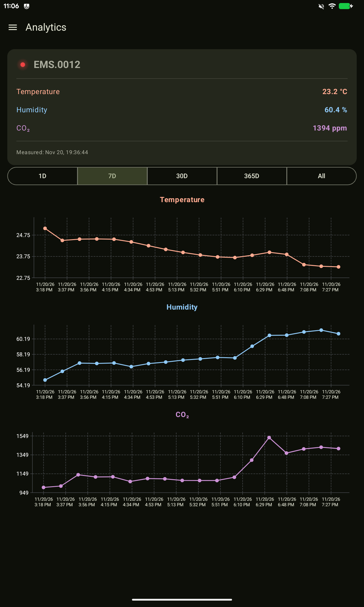

# Environment Monitor App

An android app that serves as the front end to the environment monitor system

Things that the app do:

- Display the live analytics and historical records of the environment

- Add server credentials to read the environment monitor database

- Provision wi-fi and server credentials to the Environment Monitor Device

### Analytics View

